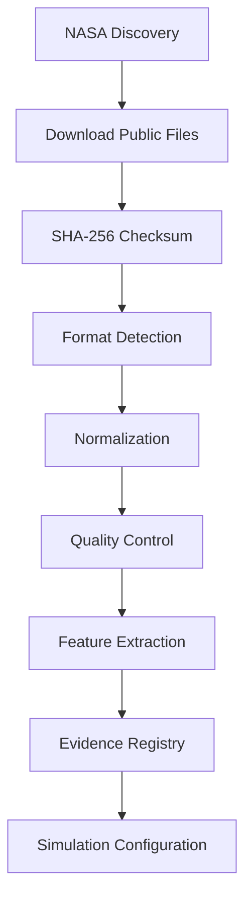

# AstroCare — Autonomous Space Triage & Resilience Analytics

**NASA Space Apps Challenge 2026**  
**Track:** Create Health Monitoring Software for Astronauts on Space Missions  
**Status:** `READY_WITH_LIMITATIONS` | **Version:** 1.0.0

---

> ⚠️ **Research prototype — not a medical device.**  
> AstroCare does not diagnose or treat medical conditions. It is a decision-support prototype for astronaut health monitoring during space missions.

<div align="center">


**Autonomous Space Triage & Resilience Analytics** — a unified health-monitoring platform for astronauts on space missions.

</div>

---

## Table of Contents

1. [Overview](#overview)
2. [The Problem](#the-problem)
3. [The Solution](#the-solution)
4. [System Architecture](#system-architecture)
5. [NASA Data Pipeline](#nasa-data-pipeline)
6. [Advanced Hybrid Simulation Engine](#advanced-hybrid-simulation-engine)
7. [Backend Brain](#backend-brain)
8. [Frontend & 3D Digital Twin](#frontend--3d-digital-twin)
9. [Core Capabilities](#core-capabilities)
10. [Technology Stack](#technology-stack)
11. [Installation & Setup](#installation--setup)
12. [Usage & Demo](#usage--demo)
13. [Testing & Quality](#testing--quality)
14. [Performance](#performance)
15. [Known Limitations](#known-limitations)
16. [License & Disclaimer](#license--disclaimer)
17. [Contributing](#contributing)

---

## 1. Overview

**AstroCare** is an autonomous astronaut health monitoring system designed for long-duration space missions. It unifies three core layers into a single offline-first prototype:

1. **NASA Open Science Data Repository (OSDR)** — public scientific evidence and laboratory data.
2. **Advanced Hybrid Simulation Engine** — physiological, environmental, cognitive, and long-duration astronaut simulation.
3. **AstroCare Brain** — clinical decision-support engine with scoring, anomaly detection, and SBAR reporting.

All three layers are connected through a shared contract layer (Pydantic v2 + TypeScript + JSON Schema Draft 2020-12) and communicate over HTTP and WebSocket.

---

## 2. The Problem

Long-duration spaceflight exposes astronauts to unique physiological risks:

| Risk | Description |
|------|-------------|
| **Cardiovascular deconditioning** | Microgravity causes fluid shifts, reduced blood volume, and orthostatic intolerance. |
| **SANS (Spaceflight-Associated Neuro-ocular Syndrome)** | Cephalad fluid shift raises intraocular pressure and can affect vision. |
| **Radiation exposure** | Galactic cosmic rays and solar particle events increase cumulative dose. |
| **Sleep & circadian disruption** | Mission schedules and isolation degrade sleep quality and cognitive performance. |
| **Musculoskeletal atrophy** | Lack of mechanical loading reduces bone density and muscle mass. |
| **Limited medical support** | Distance from Earth prevents real-time Flight Surgeon consultation during deep-space missions. |

AstroCare addresses these challenges by providing an **autonomous decision-support prototype** that processes NASA biospecimen data, simulates astronaut physiology, flags anomalies, and recommends actions — all without requiring real-time ground control.

---

## 3. The Solution

AstroCare integrates three layers into one application:

### Layer 1 — NASA OSDR Data Pipeline
Discovers, downloads, normalizes, and verifies public NASA OSDR datasets (whole blood CBC, serum multiplex, urine panels, microbiome swabs, etc.). All data is classified as `NASA_REAL` or `NASA_DERIVED` with full provenance.

### Layer 2 — Advanced Hybrid Simulation Engine
Simulates astronaut physiology (heart rate, HRV, blood pressure, SpO₂, respiration, sleep, VO₂max, fluid shift, radiation dose, etc.) using differential equations, Ornstein-Uhlenbeck noise, and individual astronaut profiles. Supports seeded scenarios (hypercapnia, sleep deprivation, SANS fluid shift, solar particle events) and What-If experiments.

### Layer 3 — Backend Brain
Validates telemetry, computes NEWS2 scores, detects clinical flags, ranks possible conditions via IMM-lite, and generates plain-language recommendations via a deterministic rule-based Fallback (with optional Ollama LLM integration).

### Layer 4 — Frontend Digital Twin
React 18 + Vite + TypeScript dashboard with an interactive 3D astronaut model, vital-sign trends, anomaly badges, scenario controls, and NASA provenance badges.

---

## 🏗 System Architecture

```mermaid
flowchart TD
    subgraph NASA [NASA OSDR API & AWS]
        N1[Study Metadata]
        N2[Public Files]
        N3[Checksum Verification]
    end

    subgraph Pipeline [Data Pipeline]
        P1[Discovery]
        P2[Ingestion]
        P3[Normalization]
        P4[Quality Control]
        P5[Evidence Registry]
    end

    subgraph Simulation [Simulation Engine]
        S1[Mission Clock]
        S2[Physiology Engine]
        S3[Environment Engine]
        S4[Sleep & Cognitive]
        S5[Adaptation]
        S6[Countermeasures]
        S7[Scenarios]
        S8[Telemetry Export]
    end

    subgraph Backend [AstroCare Brain]
        B1[Contract Validation]
        B2[NEWS2 Scoring]
        B3[Radiation Scoring]
        B4[Lifestyle Scoring]
        B5[IMM-lite Conditions]
        B6[Doctor Layer]
        B7[HTTP + WebSocket API]
    end

    subgraph Frontend [Frontend Digital Twin]
        F1[Overview Dashboard]
        F2[Health Analytics]
        F3[AI Assistant]
        F4[Training & Recovery]
        F5[Mission History]
        F6[Data Sources]
        F7[Simulation Control]
    end

    NASA --> Pipeline
    Pipeline --> Simulation
    Simulation --> Backend
    Backend --> Frontend
```



### 4.2 Component Responsibilities

| Component | Path | Responsibility |
|-----------|------|----------------|
| **Backend Brain** | `backend/src/astro_brain/` | Input validation, NEWS2, radiation/lifestyle/environment flags, IMM-lite condition ranking, Doctor Layer, HTTP + WebSocket API |
| **Frontend** | `frontend/src/` | React 18 + Vite, 3D Digital Twin, Zustand state management, Recharts charts, provenance display |
| **Simulation Engine** | `simulation_engine/` | Mission clock, physiology, environment, sleep/cognition, adaptation, countermeasures, scenarios, What-If, telemetry export |
| **Data Pipeline** | `data_pipeline/` | OSDR discovery, download, checksum verification, format detection, normalization, quality checks, feature extraction, provenance manifests |
| **Shared Contracts** | `shared/contracts.schema.json` | Canonical Pydantic v2 + TypeScript + JSON Schema Draft 2020-12 contracts |

---

## 🛰 NASA Data Pipeline

AstroCare uses the **NASA Open Science Data Repository (OSDR)** as its primary scientific source. Data is never fabricated; every measurement carries provenance (`NASA_REAL`, `NASA_DERIVED`, or `SYNTHETIC`).

### Verified OSDR Studies

| Study ID | Scope | Role in AstroCare |
|----------|-------|-------------------|
| `OSD-569` | Whole Blood Measurements from Inspiration4 (CBC, RNA-seq, WGS) | Real CBC laboratory values |
| `OSD-570` | PBMC snRNA-seq / snATAC-seq | PBMC single-nucleus omics metadata |
| `OSD-571` | Plasma Proteomics, EVPs, Metabolomics | Plasma proteomics and metabolomics metadata |
| `OSD-572` | Crew Oral, Nasal, and Skin Microbiome Swabs | Species-level microbiome abundance (Shannon diversity derivation) |
| `OSD-573` | Dragon Capsule Surface Swabs | Environmental microbiome reference |
| `OSD-575` | Serum Metabolic Panel & Immune/Cardiac Cytokine Arrays | Serum metabolic and cytokine multiplex values |
| `OSD-656` | Urine Inflammation Panel (Multiplex, NULISAseq) | Urine inflammatory panel values |

### Provenance Classes

| Class | Meaning | Example |
|-------|---------|---------|
| `NASA_REAL` | Actual NASA/OSDR measurement | CBC hemoglobin value from OSD-569 |
| `NASA_DERIVED` | Calculation over real NASA data | Shannon diversity from OSD-572 species abundance |
| `SYNTHETIC` | Generated by Simulation Engine | 1 Hz heart rate, HRV, blood pressure telemetry |

> **Important:** NASA OSDR provides short-duration biospecimen and laboratory data — **not** continuous 180-day physiological telemetry. All physiological stream values (heart rate, HRV, blood pressure, SpO₂) are generated by the Simulation Engine and labeled `SYNTHETIC`. They are never presented as real astronaut measurements.

### Acquisition Workflow



---

## 🧬 Advanced Hybrid Simulation Engine

The simulation engine models astronaut physiology over mission time using differential equations, exponential relaxation, and Ornstein-Uhlenbeck stochastic processes.

### Simulated Physiology

| System | Parameters |
|--------|------------|
| Cardiovascular | HR, HRV RMSSD, SBP, DBP |
| Respiratory | SpO₂, respiratory rate |
| Temperature | Core temperature |
| Cognitive | PVT mean RT, PVT slowest 10% RT |
| Sleep/Circadian | Sleep duration, sleep efficiency, sleep debt |
| Fluid Shift / SANS | Fluid shift index, IOP, SANS-related risk |
| Musculoskeletal | VO₂max, muscle/bone condition |
| Radiation | Dose rate, daily dose, cumulative dose |

### Individual Astronaut Profiles

| Internal ID | Public ID | Role |
|-------------|-----------|------|
| `A1` | `astro-01` | Commander |
| `A2` | `astro-02` | Mission Specialist |

A1 and A2 have different baselines, stress/CO₂ sensitivity, sleep needs, adaptation rates, and countermeasure adherence — so they produce different trajectories under identical conditions.

### Scenarios

| Scenario | Effect |
|----------|--------|
| `HYPERCAPNIC_CABIN` | Cabin ppCO₂ rises; cardiovascular and cognitive response |
| `NEUROCOGNITIVE_FATIGUE` | Sleep debt, fatigue, PVT degradation |
| `SANS_FLUID_SHIFT` | Fluid shift increase, IOP rise, SANS-related risk |
| `SOLAR_PARTICLE_EVENT` | Radiation dose rate and accumulated dose increase |
| `MISSED_ARED` | Missed ARED sessions, deconditioning |
| `ENVIRONMENTAL_EQUIPMENT_MALFUNCTION` | Environmental stress and ppCO₂ rise |

### Countermeasures

| Countermeasure | Effect |
|----------------|--------|
| ARED | Musculoskeletal support |
| Aerobic Exercise | VO₂max support |
| Sleep Intervention | Sleep debt reduction |
| Environmental Correction | Cabin CO₂ return to nominal |

Countermeasures are delayed and partial — they do not instantly restore physiology to baseline.

---

## 🖥 Frontend & 3D Digital Twin

The frontend is built with **React 18 + Vite + TypeScript + Zustand + Recharts + Three.js**.

### Main Views

| Section | Purpose |
|---------|---------|
| **Overview** | Critical alerts, overall status, vital signs, 3D body, next actions, spacecraft environment |
| **Health Analytics** | Trends, personal baselines, abnormal readings, mission explorer |
| **AI Assistant** | Role-specific briefing (Doctor, Fitness Coach, Nutritionist, Mind & Sleep) |
| **Training & Recovery** | Recovery, strain, EVA readiness, bone health |
| **Mission History** | Daily status, events (EVA, SPE, CO₂ scrubber failure), mission reports |
| **Data Sources** | NASA OSDR provenance, pipeline status, study catalog |
| **Simulation** | Lifecycle, scenarios, countermeasures, What-If controls |
| **Crew** | Crew-wide status view |
| **Risk Radar** | HRP-aligned risk visualization |
| **Routine** | Measurement routine, gamification |
| **Learn** | Glossary and education |

### 3D Digital Twin

The 3D twin displays the astronaut body as anatomical zones. Users can:

- Rotate and zoom the model
- Switch layers: skin, muscles, organs, skeleton, X-ray
- Select body zones
- View zone status by color (green / yellow / red)
- Open zone details

The twin falls back to a 2D rendering if WebGL is unavailable.

### Provenance Display

The interface distinguishes four source classes:

| Class | Meaning |
|-------|---------|
| `NASA_REAL` | Actual NASA/OSDR measurement |
| `NASA_DERIVED` | Calculation from real NASA data |
| `SYNTHETIC` | Simulation engine generation |
| `SYNTHETIC_FALLBACK` | Synthetic data used to fill a missing demo signal |

---

## 🛠 Technology Stack

| Layer | Technology | Purpose |
|-------|------------|---------|
| Backend | Python 3.11+, Pydantic v2 | Scientific computing, strict data validation |
| Frontend | React 18, Vite, TypeScript | UI and state management |
| Frontend State | Zustand | Client state and live telemetry ring buffer |
| Frontend Charts | Recharts | Vital sign trends |
| Frontend 3D | Three.js / React Three Fiber | 3D astronaut Digital Twin |
| Frontend Validation | zod | Runtime BrainTick contract validation |
| OSDR API | NASA Open Science Data Repository | Public study metadata and files |
| Checksums | SHA-256 | Download integrity |
| Storage | JSON / JSONL / SQLite | Artifact storage and offline bundle |
| Diagrams | Mermaid | Architecture and flow diagrams |

---

## 🛠 Installation & Setup

### Prerequisites

| Requirement | Version |
|-------------|---------|
| Python | 3.11+ |
| Node.js | 20+ / npm |
| Git | Any recent version |
| GPU | Not required |

### 1. Clone the Repository

```bash
git clone https://github.com/Atambek07/astrocare.git
cd astrocare
```

### 2. Backend Setup

```bash
# Create and activate Python virtual environment
python3 -m venv backend/.venv
source backend/.venv/bin/activate

# Install backend dependencies
pip install -e backend[dev]
```

### 3. Frontend Setup

```bash
cd frontend
npm install
cd ..
```

### 4. NASA Data Acquisition

The repository includes a verified NASA evidence bundle under `data/`. To rebuild the NASA pipeline:

```bash
python -m data_pipeline.build_offline_bundle
```

For offline rebuild (uses cached OSDR metadata):

```bash
ASTRALIS_OFFLINE_DATA=1 python -m data_pipeline.build_offline_bundle
```

### 5. Start the Unified Application

```bash
# Start backend, frontend, and simulation engine together
scripts/run.sh
```

Optional: start with a scenario pre-loaded:

```bash
scripts/run.sh HYPERCAPNIC_CABIN
```

### Default URLs

| Service | URL |
|---------|-----|
| Frontend | http://localhost:3000 |
| Backend API | http://localhost:8765 |
| WebSocket | ws://localhost:8787 |

### 6. Simulation CLI

```bash
# 60-minute 1 Hz telemetry simulation
python -m simulation_engine.cli \
  --duration-seconds 3600 \
  --internal-step 1.0 \
  --output-step 1.0 \
  --export-dir simulation_exports \
  --format jsonl \
  --summary

# 180-day historical simulation
python -m simulation_engine.cli \
  --duration-seconds 15552000 \
  --internal-step 300 \
  --output-step 300 \
  --format jsonl \
  --summary
```

### 7. Docker Compose (Alternative)

```bash
docker compose up --build
```

> **Note:** The native startup path (`scripts/run.sh`) is the primary verified deployment method. Docker Compose is provided for convenience.

---

## 📊 Usage & Demo

### Stage 1 — NASA Evidence

Open **http://localhost:3000** and navigate to **Data Sources**.

Show:
1. NASA OSDR source
2. Verified study identifiers
3. Accepted and rejected studies
4. Processing pipeline stages
5. Quality status
6. Provenance classes

> NASA data is laboratory/biospecimen evidence — not continuous astronaut telemetry.

### Stage 2 — Simulation Initialization

Open **Simulation**.

Confirm:
- `astro-01` and `astro-02`
- Mission day and phase
- Simulation speed
- Environment state

Press **Start** if the mission is paused.

### Stage 3 — Live Telemetry

Return to **Overview**.

Show:
- Active mode `LIVE BACKEND`
- HR, BP, SpO₂, respiration, temperature
- Brain recommendation
- Active flags
- Digital Twin zones

All telemetry is labeled `SYNTHETIC`.

### Stage 4 — Hypercapnic Cabin

In **Simulation**, start:

```text
HYPERCAPNIC_CABIN
```

Observe:
1. Cabin ppCO₂ rising
2. HR and respiration changing
3. Brain flags appearing
4. Digital Twin zone status changing
5. Doctor recommendation updating

### Stage 5 — Countermeasure and Recovery

Apply:

```text
ENVIRONMENTAL_CORRECTION
```

Then optionally:

```text
SLEEP_INTERVENTION
```

Explain that recovery is gradual, not instant.

### Stage 6 — Solar Particle Event

Start:

```text
SOLAR_PARTICLE_EVENT
```

Show:
- Rising radiation dose rate
- Increasing daily dose
- Increasing cumulative dose
- Brain radiation flags
- Mission history event

### Stage 7 — What-If

Use the **What-If** buttons in Simulation:

- Missed ARED 7 days
- Sleep −2 h/day
- ppCO₂ 5 mmHg

Explain that the experiment is isolated and the baseline mission is unchanged.

### Stage 8 — Stop

Press `Ctrl+C` in the terminal running `scripts/run.sh`.

---

## 🧪 Testing & Quality

Run the full test suite:

```bash
scripts/test.sh
```

| Gate | Command | Result |
|------|---------|--------|
| Backend Brain | `backend/.venv/bin/python -m pytest -q` | **656 passed** |
| Frontend | `npm test` | **39 passed** |
| NASA Data Pipeline | `pytest data_pipeline/tests -q` | **10 passed** |
| Simulation | pytest simulation tests | **30 passed** |
| Frontend Build | `npm run build` | PASS |
| Shared Schema | `--check` | PASS |
| HTTP Endpoints | live service checks | PASS |
| WebSocket | live frame check | PASS |

### Backend Test Coverage

- Strict input contract validation
- NEWS2 components and aggregate risk
- Radiation flags and cumulative limits
- Lifestyle and environment flags
- IMM-lite condition ranking
- Doctor Layer cache, timeout, and fallback behavior
- Dashboard state, history, reports, and ask endpoint
- WebSocket framing and malformed clients

### Frontend Test Coverage

- BrainTick contract rejection and acceptance behavior
- Trend classification
- Triage rules
- Hard triggers
- MFI thresholds
- Personal baseline behavior

Production build additionally verifies TypeScript and static generation.

### Simulation Test Coverage

- 60-minute 1 Hz telemetry generation
- Deterministic reproducibility
- Shared-contract serialization
- Hypercapnic and solar particle event scenarios
- Scenario termination and recovery
- Checkpoint round-trip
- Telemetry export
- Astronaut divergence
- Countermeasure effect
- Mission-time monotonicity
- Event provenance
- 180-day feasibility
- Finite values across integration steps
- Physiological bounds
- Radiation monotonicity
- Step-size sensitivity
- What-If sleep and ARED effects

---

## 📈 Performance

Measured on a CPU-only local development workstation (no GPU required):

| Test | Configuration | Runtime | Max RSS |
|------|-------------|---------|---------|
| 60-minute simulation | 2 astronauts, 1 Hz | 0.93 s | ~39 MiB |
| 180-day simulation | 2 astronauts, 300 s step | 6.81 s | ~128 MiB |
| Frontend production build | Next.js production | 27.74 s | ~720 MiB |

### Integration Latency

| Operation | Result |
|-----------|--------|
| Simulation status HTTP query | Immediate local response |
| Scenario start/terminate | Immediate local response |
| What-If 10-minute experiment | Completed within synchronous request |
| WebSocket first tick | Received immediately after service start |

---

## ⚠️ Known Limitations

1. **Not clinically validated.** AstroCare is a research prototype, not a medical device.
2. **No continuous NASA astronaut telemetry.** NASA OSDR provides laboratory and biospecimen data; continuous HR/HRV/BP/SpO₂ telemetry is synthetic.
3. **Simulation coefficients include engineering assumptions.** Not all parameters are calibrated to individual astronaut data.
4. **SANS-related risk is an engineering indicator.** It is not a measurement of intracranial pressure or a SANS diagnosis.
5. **Radiation is accumulated dose.** Particle transport and tissue-dose modeling are not implemented.
6. **`SimulationEvent` is an internal contract.** It is not yet an Architect-approved shared contract.
7. **Browser automation is not installed.** Live E2E testing is service-level, not browser-level.
8. **Docker Compose is provided but native startup is the verified primary path.**
9. **Local AI model verified only with `qwen2.5:7b-instruct`.** Smaller 1.5B and 3B models were not tested with the current prompt.

---

## 📄 License & Disclaimer

**License:** MIT (see `LICENSE`).

**Medical Disclaimer:**

AstroCare is a research prototype — **not a medical device.**  
It does not diagnose, treat, or prevent any medical condition. NEWS2 was developed for adult hospital patients and has not been validated for astronauts or microgravity. SpO₂, blood pressure, temperature, and consciousness may be confounded by spaceflight conditions. Outputs must not be used as validated clinical instruments or for real medical decisions.

All synthetic physiological telemetry is explicitly labeled `SYNTHETIC` and is not derived from real astronaut measurements.

---

## 🤝 Contributing

1. Fork the repository
2. Create your feature branch (`git checkout -b feature/your-feature`)
3. Commit your changes (`git commit -m 'feat: your feature'`)
4. Push to the branch (`git push origin feature/your-feature`)
5. Open a Pull Request

Please run `scripts/test.sh` before submitting a pull request.

---

## 📞 Contact

**ASTRALIS + IMPACT Team**  
NASA Space Apps Challenge 2026  
Track: Create Health Monitoring Software for Astronauts on Space Missions

---

<div align="center">

*Built with ❤️ for autonomous astronaut health monitoring*

</div>
