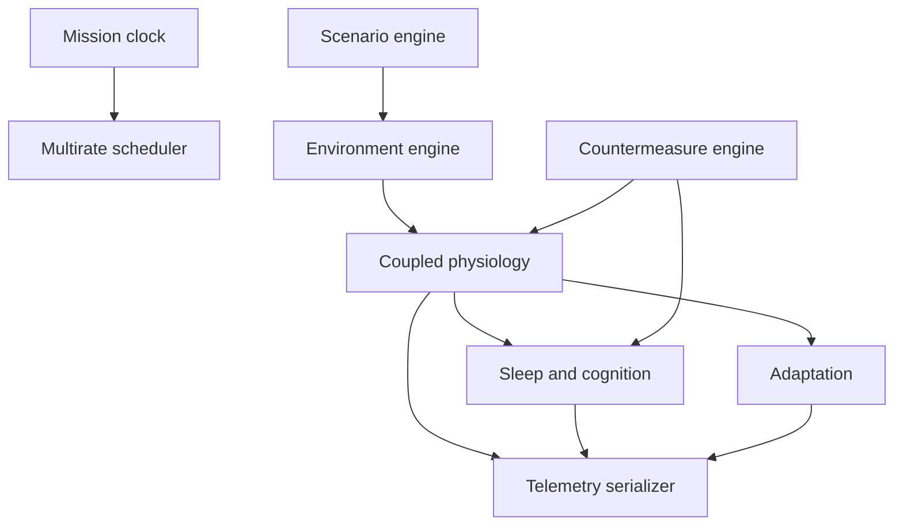

# Advanced Hybrid Simulation

**Engine version:** `astralis-simulation-1.0.0`  
**Model version:** `astralis-hybrid-physiology-1.0.0`  
**Output classification:** `SYNTHETIC`

---

## 1. Purpose

The simulation engine generates physiologically structured, reproducible mission telemetry. It exercises the Brain and frontend in the absence of continuous NASA astronaut telemetry.

---

## 2. Architecture



---

## 3. Modules

| Module | Responsibility |
| --- | --- |
| `clock.py` | Mission time, day, phase and speed. |
| `environment_engine.py` | ppCO2, radiation accumulation and environmental stress. |
| `physiology_engine.py` | Coupled cardiovascular, respiratory, cognitive and adaptation dynamics. |
| `countermeasure_engine.py` | ARED, aerobic exercise, sleep intervention, recovery. |
| `scenarios.py` | Scenario catalog and lifecycle. |
| `what_if.py` | Isolated experiment execution and comparison. |
| `telemetry.py` | Shared-contract serialization. |
| `controller.py` | Lifecycle, snapshots, export, checkpoints. |

---

## 4. State vector

Representative state:

```text
x(t) = [
    HR,
    HRV_RMSSD,
    SBP,
    DBP,
    SpO2,
    respiratory_rate,
    temperature,
    fatigue,
    sleep_debt,
    cognitive/PVT state,
    fluid_shift,
    SANS_risk,
    IOP,
    cardiovascular_adaptation,
    musculoskeletal_condition,
    VO2max
]
```

Environment and behavior inputs:

```text
u(t) = [
    cabin_ppCO2,
    radiation_dose_rate,
    microgravity_exposure,
    environmental_stress,
    exercise_load,
    sleep_schedule
]
```

---

## 5. Numerical integration

| Method | Use |
| --- | --- |
| Exponential relaxation | Fast physiological target states. |
| Explicit Euler | Scalar state transitions. |
| RK4 | Available for suitable continuous states. |
| OU process | Correlated stochastic variation. |
| Daily update | Sleep, countermeasures and long-term state. |

Supported internal steps in tests: 1, 5, 30 and 300 seconds.

---

## 6. Multiscale schedule

| Process | Typical update |
| --- | --- |
| Telemetry output | 1 s in live mode; 300 s in 180-day historical mode |
| Fast physiology | 1-30 s |
| Cognition and fatigue | minutes |
| Sleep and countermeasures | daily |
| Adaptation | day-scale relaxation |

---

## 7. Astronaut profiles

| Internal ID | Public ID | Role |
| --- | --- | --- |
| `A1` | `astro-01` | Commander, higher stress/CO2 sensitivity. |
| `A2` | `astro-02` | Mission specialist, control-like profile. |

Profiles differ in:

- HR/HRV baselines;
- CO2 and stress response;
- sleep need and efficiency;
- adaptation timescales;
- countermeasure adherence;
- stochastic variability.

---

## 8. Environment model

### ppCO2

ppCO2 relaxes toward either the nominal cabin value or an active scenario target. OU noise provides short-term variation.

### Radiation

Radiation uses a baseline dose-rate process and accumulates monotonically:

```text
ΔmSv = dose_rate_mSv/h × Δt_h
```

### Environmental stress

Environmental stress relaxes toward a baseline and is perturbed by scenarios.

---

## 9. Scenarios

| Scenario | Primary effect |
| --- | --- |
| `HYPERCAPNIC_CABIN` | ppCO2 rises; cardiopulmonary and cognitive response. |
| `NEUROCOGNITIVE_FATIGUE` | Sleep debt, fatigue and PVT degradation. |
| `SANS_FLUID_SHIFT` | Fluid shift and IOP rise. |
| `SOLAR_PARTICLE_EVENT` | Radiation dose rate and accumulated dose rise. |
| `MISSED_ARED` | ARED schedule missed; deconditioning path exercised. |
| `ENVIRONMENTAL_EQUIPMENT_MALFUNCTION` | Environmental stress and ppCO2 rise. |

Scenarios have ramp-in, duration, termination and recovery behavior.

---

## 10. Countermeasures

| Countermeasure | State effect |
| --- | --- |
| ARED | Musculoskeletal condition, VO2max contribution, exercise load. |
| Aerobic exercise | VO2max and exercise load. |
| Sleep intervention | Sleep debt and subsequent sleep penalty. |
| Environmental correction | ppCO2 target, stress and fatigue. |

Effects are delayed and partial.

---

## 11. What-If methodology

1. Snapshot the original mission.
2. Create an isolated controller from a deep copy.
3. Restore the baseline state.
4. Apply the modification to the cloned configuration/state.
5. Advance only the experiment.
6. Compare selected metrics.
7. Return differences, events and limitations.

The original mission is not mutated.

---

## 12. Export and checkpoints

Supported formats:

- JSON;
- JSONL;
- CSV;
- all.

Checkpoint payload includes configuration, clock, environment, astronaut states, scenario state, status and events.

---

## 13. Known limitations

1. Continuous output is synthetic.
2. Model parameters are not clinically calibrated.
3. No pharmacological, injury or unconfigured disease process is modeled.
4. Scenario severity is engineered, not empirically fit to a specific event.
5. Long-duration projections demonstrate sensitivity rather than validated forecasts.
