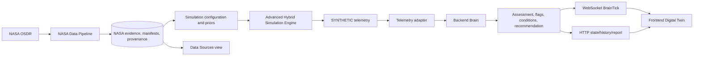
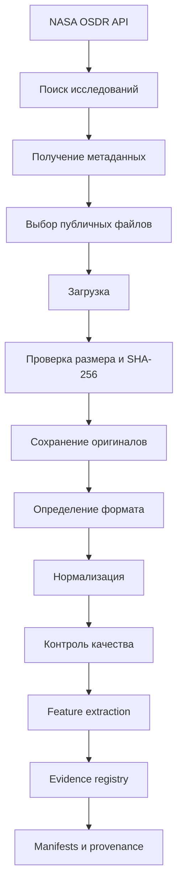
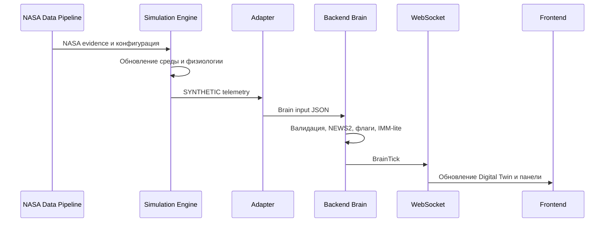

# AstroCare — полное техническое описание проекта

**Версия документа:** 2026-11-15  
**Аудитория:** разработчики, технические специалисты, участники команды и новые члены проекта.  
**Статус системы:** исследовательский прототип для демонстрации и инженерной оценки. Это **не** медицинское изделие и не клинически валидированная диагностическая система.

---

## 1. Общая информация о проекте

### 1.1 Что такое AstroCare

AstroCare — интегрированная система мониторинга состояния здоровья астронавтов во время длительных космических миссий. Она объединяет четыре подсистемы:

1. **NASA Data Pipeline** — загрузка и обработка открытых научных данных NASA OSDR.
2. **Advanced Hybrid Simulation Engine** — гибридная симуляция физиологии, среды и долгосрочной адаптации.
3. **Backend Brain** — аналитическое ядро с оценкой рисков, флагами, состояниями и рекомендациями.
4. **Frontend Digital Twin** — интерактивный 3D-интерфейс и информационная панель.

Система построена как единый продукт, а не как набор отдельных демонстраций. Данные проходят прозрачную цепочку:

```text
NASA OSDR → обработка и доказательная база → симуляция → аналитика Brain → интерфейс
```

### 1.2 Основная идея

AstroCare отвечает на три вопроса:

1. **Что происходит с астронавтом сейчас?**
2. **Какие отклонения или риски можно увидеть по текущим показателям?**
3. **Как может развиваться состояние при изменении условий миссии?**

Проект не пытается заменить врача. Его цель — дать экипажу и наземной команде понятный инструмент раннего предупреждения и поддержки решений.

### 1.3 Зачем это нужно

В длительном полёте медицинская помощь ограничена:

- связь с Землёй может задерживаться;
- эвакуация невозможна или крайне сложна;
- экипаж может не включать врача;
- часть симптомов развивается постепенно;
- некоторые состояния опасны именно при длительном воздействии.

Поэтому важно не просто отображать отдельные числа, а связывать их в общую картину: среду, физиологию, сон, когнитивное состояние, нагрузку и накопленные эффекты.

### 1.4 Для кого предназначена система

| Пользователь | Что получает |
| --- | --- |
| Астронавт | Понятный статус, предупреждения и шаги самоконтроля. |
| Экипаж | Общий обзор состояния членов команды. |
| Наземный медицинский специалист | Отчёты, историю, активные флаги и возможные состояния. |
| Инженер/исследователь | Прозрачность данных, симуляционные сценарии и What-If анализ. |

---

## 2. Какую проблему решает AstroCare

### 2.1 Основные риски длительных миссий

| Риск | Почему это важно | Как отражён в AstroCare |
| --- | --- | --- |
| Сердечно-сосудистая адаптация | Микрогравитация изменяет распределение жидкостей и сосудистый тонус. | HR, HRV RMSSD, давление, ортостатические и сердечно-сосудистые флаги. |
| Воздействие радиации | Доза накапливается и может влиять на долгосрочный риск. | Мгновенная мощность дозы, дневная и накопленная доза, радиационные флаги. |
| Нарушения сна | Усталость снижает внимание и реакцию. | Длительность сна, эффективность, долг сна, PVT-метрики. |
| Когнитивные изменения | Ошибки опасны при управлении системами и EVA. | PVT mean RT, PVT slowest 10%, количество провалов. |
| Микрогравитация и жидкость | Перераспределение жидкости связано с неврологическими и глазными рисками. | Fluid shift index, IOP, SANS-related risk. |
| Мышцы и кости | Без нагрузки происходит детренированность. | VO2max, состояние опорно-двигательной системы, ARED. |
| Среда кабины | Повышенный CO2 влияет на дыхание, самочувствие и когнитивные функции. | Cabin ppCO2 и связанные флаги. |
| Ограниченная медицинская помощь | Решения часто нужно принимать до полной консультации с Землёй. | Операционные флаги, планы, протоколы и отчёты. |

### 2.2 Почему мало просто показывать числа

Отдельное значение, например HR 96 bpm, само по себе малоинформативно. Оно может быть нормой после нагрузки, признаком стресса, обезвоживания, плохого сна или реакции на CO2.

AstroCare связывает показатели между собой:

- повышенный CO2 + замедленный PVT + сниженная HRV — один паттерн;
- длительный долг сна + низкая эффективность сна — другой;
- повышенная доза радиации — отдельный операционный риск;
- пропущенные тренировки — долгосрочный детренированность-риск.

Именно поэтому важны не только текущие измерения, но и анализ рисков, накопленных эффектов и симуляция развития состояния.

---

## 3. Общая архитектура AstroCare

### 3.1 Высокоуровневая схема



### 3.2 Компоненты

| Компонент | Каталог | Главная роль |
| --- | --- | --- |
| NASA Data Pipeline | `data_pipeline/` | Поиск, загрузка, проверка, нормализация и описание происхождения данных NASA. |
| Advanced Hybrid Simulation Engine | `simulation_engine/` | Моделирование физиологии, среды, адаптации и сценариев. |
| Backend Brain | `backend/src/astro_brain/` | Валидация входа, скоринг, флаги, состояния, рекомендации и отчёты. |
| Frontend | `frontend/` | 3D Digital Twin, аналитика, управление симуляцией, отображение предупреждений. |
| Integration Layer | `backend/src/astro_brain/astrocare_service.py`, `adapters/`, `frontend/src/lib/` | Согласование контрактов, HTTP/WebSocket, преобразование единиц и ID. |
| Shared contracts | `shared/` | Общие Pydantic-модели и JSON Schema. |

---

## 4. Frontend и Digital Twin

### 4.1 Что реализовано

Frontend — это Next.js-приложение с клиентским состоянием на Zustand. Основной интерфейс — интерактивный 3D Digital Twin.

Реализованные разделы:

| Раздел | Что делает |
| --- | --- |
| Overview | Главный статус, важные предупреждения, витальные показатели, 3D-тело, среда кабины. |
| Health Analytics | Тренды, личные базовые диапазоны, отклонения, обзор миссии. |
| AI Assistant | Локальный объясняющий ассистент по правилам проекта. |
| Training & Recovery | Восстановление, нагрузка, готовность, состояние мышц и костей. |
| Mission History | Дневной статус, события и история демонстрационной миссии. |
| Data Sources | NASA OSDR, статус пайплайна, происхождение данных и доказательства. |
| Simulation | Запуск, пауза, скорость, сценарии, контрмеры, What-If. |
| Crew | Обзор экипажа. |
| Learn | Справочные объяснения. |

### 4.2 3D Digital Twin

Digital Twin отображает тело астронавта как набор анатомических зон. Пользователь может:

- вращать и приближать модель;
- переключать слои: кожа, мышцы, органы, скелет, рентген-режим;
- выбирать зоны тела;
- видеть статус зоны по цвету и тексту;
- открывать детали зоны;
- переходить от показателя к соответствующей зоне тела.

Поддерживается 3D-режим и 2D-фолбэк, если WebGL недоступен или 3D-модель не загружается.

### 4.3 Состояния данных

Frontend явно различает:

| Режим | Значение |
| --- | --- |
| LIVE BACKEND | Данные приходят от реального Backend Brain. |
| DEMO MOCK | Backend недоступен, используется локальный демонстрационный генератор. |
| NASA REAL | Реальные значения из NASA OSDR. |
| NASA DERIVED | Значения, рассчитанные из реальных данных NASA. |
| SYNTHETIC | Значения, созданные Simulation Engine. |

Важно: mock-режим не подменяет backend незаметно. Он всегда помечается как демонстрационный.

---

## 5. Backend Brain — аналитическое ядро

### 5.1 Что принимает Brain

Brain принимает один JSON-объект на один момент времени для одного астронавта. Основные поля:

- `timestamp`;
- `astronaut_id`;
- `hr`;
- `spo2`;
- `bp.systolic`;
- `bp.diastolic`;
- `temp_c`;
- `resp_rate`;
- `radiation_dose_rate`;
- `exercise_minutes_today`;
- `required_exercise_minutes`;
- `caloric_intake`;
- `caloric_target`;
- `sleep_hours`;
- `mood_score`;
- `mission_day`;
- `mission_phase`;
- `cabin_ppco2_mmhg`;
- `iop_mmhg`;
- `hrv_rmssd_ms`;
- `pvt_slowest10_rt_ms`.

Контракт строгий: неправильный тип, единица или диапазон приводят к ошибке валидации. Brain не угадывает значения.

### 5.2 Что делает Brain

| Модуль | Функция |
| --- | --- |
| `contract.py` | Строгая валидация входного образца. |
| `news2.py`, `vitals_flags.py` | NEWS2-оценка и связанные флаги. |
| `radiation.py` | Радиационные флаги по мощности и накопленной дозе. |
| `lifestyle.py` | Тренировки, калории, сон, настроение. |
| `environment.py` | CO2 кабины и связанные риски. |
| `conditions.py` | IMM-lite-ранжирование возможных состояний. |
| `doctor/` | Генерация рекомендации: локальная модель, кэш или детерминированный fallback. |
| `mission_log.py` | Эпизоды, отчёты и история миссии. |
| `plans.py` | Планы упражнений и питания. |
| `pipeline.py` | Основной класс `Brain.process()`. |

### 5.3 Выход Brain

Brain возвращает объект с полями:

- `timestamp`;
- `astronautId`;
- `alertLevel`: `green`, `yellow`, `red`;
- `news2Score`;
- `activeFlags`;
- `flagDetails`;
- `likelyConditions`;
- `doctorRecommendation`;
- `doctorSource`;
- `bodySystems`;
- `plans`;
- дополнительные поля миссии и медицинского набора.

Важно: `alertLevel` — это результат Backend Brain. Frontend не пересчитывает медицинскую логику.

### 5.4 Doctor Layer

Doctor Layer работает по принципу деградации:

1. Если результат уже есть в кэше, возвращается кэшированный текст.
2. Если включён локальный Ollama, делается попытка запроса к модели.
3. Если модель недоступна или не отвечает, используется детерминированный rule-based fallback.

Поле `doctorSource` показывает, откуда пришёл текст: `llm`, `cache` или `fallback`. Это сохраняет честность системы.

---

## 6. NASA Data Pipeline

### 6.1 Путь данных



### 6.2 Реально использованные исследования NASA OSDR

| Study ID | Тип данных | Роль в AstroCare |
| --- | --- | --- |
| OSD-569 | Whole blood, CBC, omics | Реальные лабораторные значения CBC. |
| OSD-570 | PBMC snRNA/snATAC, immune repertoire | Метаданные и отобранные публичные файлы. |
| OSD-571 | Plasma proteomics, EVPs, metabolomics | Метаданные и обработанные таблицы. |
| OSD-572 | Oral/nasal/skin microbiome | Расчёт Shannon diversity. |
| OSD-573 | Dragon capsule microbiome | Данные среды и микробиома. |
| OSD-575 | CMP, serum immune/cardiac panels | Сывороточные лабораторные значения. |
| OSD-656 | Urine inflammation panel | Мочевые воспалительные панели. |

Дополнительно каталогизированы другие исследования. Нерелевантные записи не отбрасываются молча: они остаются в каталоге с явной причиной отклонения.

### 6.3 Три категории происхождения данных

| Категория | Что означает | Пример |
| --- | --- | --- |
| `NASA_REAL` | Реальное значение или метаданные из NASA OSDR. | Значение гемоглобина из OSD-569. |
| `NASA_DERIVED` | Значение, рассчитанное из реальных данных NASA по описанному методу. | Shannon diversity из таблицы видов OSD-572. |
| `SYNTHETIC` | Значение, сгенерированное Simulation Engine. | Синтетический 1 Hz поток HR/HRV. |

Эти категории не смешиваются. Если значение сгенерировано, оно никогда не помечается как `NASA_REAL`.

### 6.4 Что реально получено

По текущему бандлу:

- 79 каталогизированных исследований;
- 71 принято;
- 8 отклонено с указанием причины;
- 23 174 реальных лабораторных значения;
- 133 реальных лабораторных группировки;
- 329 образцов микробиома;
- 327 валидных значений Shannon diversity;
- 31 339 provenance-записей в исходном бандле.

Важное ограничение: данные NASA — это лабораторные и биоспецименные данные, а не непрерывная телеметрия HR/HRV/давления/SpO2. Поэтому непрерывные физиологические сигналы создаёт Simulation Engine и помечает их как `SYNTHETIC`.

---

## 7. Advanced Hybrid Simulation Engine

### 7.1 Что моделирует Simulation Engine

Simulation Engine создаёт динамическую модель астронавта и среды миссии. Он моделирует:

- сердечно-сосудистые показатели;
- дыхание и SpO2;
- температуру;
- усталость и стресс;
- сон и долг сна;
- когнитивную производительность;
- перераспределение жидкостей;
- SANS-related risk и IOP;
- состояние мышц и костей;
- VO2max;
- CO2 в кабине;
- радиацию и накопленную дозу;
- влияние контрмер.

### 7.2 Почему подход гибридный

Гибридный подход означает, что система комбинирует разные математические механизмы вместо того, чтобы сводить всё к случайным числам.

| Механизм | Зачем нужен |
| --- | --- |
| Дифференциальные уравнения / целевые релаксации | Моделируют плавную физиологическую динамику. |
| Экспоненциальное приближение к цели | Показывает, что состояние не меняется мгновенно. |
| Ornstein-Uhlenbeck noise | Добавляет связанный, а не чисто белый шум. |
| Дискретные обновления | Используются для сна, тренировок и суточной адаптации. |
| Rule-based сценарии | Позволяют управлять проверяемыми событиями. |
| Индивидуальные профили | Делают реакции A1/A2 разными. |

### 7.3 Временные масштабы

Разные процессы обновляются с разной частотой.

| Процесс | Масштаб |
| --- | --- |
| Телеметрия | 1 Hz в live-режиме или настраиваемый шаг |
| HR, HRV, BP, SpO2, дыхание | секунды |
| Усталость и когнитивные функции | минуты |
| Сон и контрмеры | сутки |
| Жидкость, SANS-related risk, мышцы, VO2max | дни и недели |

Это позволяет моделировать 60 минут, сутки, 7 дней, 30 дней, 90 дней и 180 дней без избыточных вычислений.

### 7.4 Профили астронавтов

| Внутренний ID | Публичный ID | Роль |
| --- | --- | --- |
| `A1` | `astro-01` | Commander, более высокая чувствительность к стрессу и CO2. |
| `A2` | `astro-02` | Mission Specialist, контрольный профиль. |

У них разные:

- базовые HR/HRV/давление;
- чувствительность к CO2 и стрессу;
- потребность во сне;
- скорость адаптации;
- adherence к тренировкам;
- стохастическая вариативность.

Поэтому при одинаковой среде траектории не идентичны.

### 7.5 Роль данных NASA

Данные NASA используются для:

- доказательных диапазонов;
- направления физиологических зависимостей;
- baseline-статистик;
- проверки того, какие параметры вообще доступны;
- формирования evidence registry.

Но NASA не даёт непрерывной телеметрии всех показателей. Поэтому параметр может быть:

| Классификация | Значение |
| --- | --- |
| `NASA_MEASURED` | Прямо измерено NASA. |
| `PUBLISHED_SCIENTIFIC` | Опирается на опубликованные научные данные. |
| `DERIVED_PARAMETER` | Получено из опубликованной зависимости. |
| `MODEL_ASSUMPTION` | Инженерное допущение. |
| `SYNTHETIC_DEMONSTRATION` | Демонстрационный параметр симуляции. |

### 7.6 Пример принципа работы

Астронавт находится в микрогравитации несколько недель. Simulation Engine постепенно увеличивает fluid shift index. Это влияет на IOP и SANS-related risk. Параллельно Brain получает телеметрию, видит изменение IOP и добавляет соответствующий флаг. Frontend подсвечивает зону глаз и показывает возможное состояние для наблюдения.

Это пример принципа работы модели, а не доказательство того, что система предсказывает реальную клиническую SANS-патологию у конкретного астронавта.

---

## 8. Как работает система: полный сценарий



### 8.1 Пошагово

1. NASA Data Pipeline получает и обрабатывает открытые данные OSDR.
2. Создаётся реестр доказательств и происхождения.
3. Выбирается или инициализируется профиль астронавта.
4. Simulation Engine обновляет состояние организма с учётом среды, контрмер и индивидуальных параметров.
5. Adapter переводит состояние симуляции в контракт Backend Brain.
6. Brain валидирует вход и выполняет анализ.
7. Brain формирует `alertLevel`, флаги, возможные состояния и рекомендацию.
8. WebSocket передаёт BrainTick во frontend.
9. Frontend обновляет витальные показатели, Digital Twin, предупреждения и раздел Data Sources.
10. Пользователь может запустить сценарий или What-If эксперимент.

---

## 9. Реализованные сценарии и контрмеры

### 9.1 Сценарии

| Сценарий | Что моделирует | Статус |
| --- | --- | --- |
| `HYPERCAPNIC_CABIN` | Повышение CO2 в кабине и реакция организма. | Реализован. |
| `NEUROCOGNITIVE_FATIGUE` | Недосып, циркадный сдвиг, ухудшение PVT. | Реализован. |
| `SANS_FLUID_SHIFT` | Перераспределение жидкости, IOP, SANS-related risk. | Реализован. |
| `SOLAR_PARTICLE_EVENT` | Рост радиационной мощности и накопленной дозы. | Реализован. |
| `MISSED_ARED` | Пропущенные тренировки и детренированность. | Реализован. |
| `ENVIRONMENTAL_EQUIPMENT_MALFUNCTION` | Неисправность системы среды. | Реализован. |

### 9.2 Контрмеры

| Контрмера | Что моделирует | Статус |
| --- | --- | --- |
| ARED | Сопротивление и поддержка мышц/костей. | Реализована. |
| Aerobic exercise | Влияние на VO2max. | Реализована. |
| Sleep intervention | Снижение долга сна и улучшение восстановления. | Реализована. |
| Environmental correction | Возврат CO2 к норме и снижение стресса. | Реализована. |

Контрмеры не возвращают показатели мгновенно к норме. Эффект отложенный и частичный.

---

## 10. What-If сценарии

What-If позволяет сравнить альтернативный сценарий с базовым, не изменяя основную миссию.

Поддерживаемые модификации:

| Что-If параметр | Значение |
| --- | --- |
| `ppco2_target_mmhg` | Целевой уровень CO2 в кабине. |
| `sleep_duration_delta_h` | Изменение продолжительности сна. |
| `sleep_need_delta_h` | Изменение потребности во сне. |
| `ared_adherence_delta` | Изменение adherence к ARED. |
| `aerobic_adherence_delta` | Изменение adherence к аэробной нагрузке. |
| `radiation_dose_rate_delta_msv_h` | Изменение мощности дозы. |
| `missed_ared_days` | Запуск сценария пропущенных ARED. |
| `sleep_intervention_effectiveness` | Эффективность сна-интервенции. |
| `scenario_id` | Явное добавление сценария. |

Что-If работает на изолированной копии состояния:

```text
Исходная миссия → snapshot → копия → модификация → прогон → сравнение
```

Исходная миссия не изменяется.

---

## 11. Основные возможности AstroCare

| Функция | Что делает | Для чего нужна |
| --- | --- | --- |
| Health Monitoring | Отображает HR, BP, SpO2, дыхание, температуру, радиацию, CO2 и другие показатели. | Даёт текущую картину состояния астронавта. |
| Risk Analysis | Формирует флаги, уровни тревоги и возможные состояния через Backend Brain. | Помогает раньше увидеть отклонение от нормального состояния. |
| Anomaly Detection | Использует NEWS2, радиационные, lifestyle- и environment-флаги. | Обнаруживает клинические и операционные отклонения. |
| Digital Twin | Показывает 3D-тело, зоны и слои. | Связывает абстрактные показатели с анатомией. |
| Hybrid Simulation | Генерирует синтетическую телеметрию и долгосрочные траектории. | Позволяет тестировать систему и демонстрировать развитие состояния. |
| What-If Scenarios | Сравнивает альтернативные условия миссии. | Помогает оценить последствия решений без риска для миссии. |
| NASA Data Integration | Загружает и обрабатывает публичные данные NASA OSDR. | Обеспечивает научную доказательную базу и прозрачность. |
| Data Provenance | Разделяет `NASA_REAL`, `NASA_DERIVED` и `SYNTHETIC`. | Предотвращает подмену реальных данных симуляцией. |
| Reports | Формирует отчёты и историю эпизодов. | Поддерживает связь с наземной командой. |

---

## 12. Интеграционный слой

### 12.1 Основные точки интеграции

| Точка | Файл/модуль | Функция |
| --- | --- | --- |
| Симуляция → Backend | `backend/src/astro_brain/astrocare_service.py` | Формирует Brain input из состояния симуляции. |
| Тик → Backend | `backend/src/astro_brain/adapters/astralis.py` | Преобразует телеметрию в контракт Brain. |
| Brain → Frontend | `backend/src/astro_brain/adapters/frontend.py` | Формирует BrainTick для Digital Twin. |
| Frontend HTTP | `frontend/src/lib/backend.ts` | Использует `NEXT_PUBLIC_BACKEND_HTTP_URL`. |
| Frontend WebSocket | `frontend/src/lib/brainSocket.ts` | Подключается к `NEXT_PUBLIC_BRAIN_WS_URL`. |
| Общие контракты | `shared/contracts.py`, `shared/contracts.schema.json` | Единые модели и JSON Schema. |

### 12.2 Ключевые API

| Метод | Путь | Назначение |
| --- | --- | --- |
| POST | `/ingest` | Обработать один образец через Brain. |
| GET | `/state` | Последнее состояние. |
| GET | `/state/all` | Последние состояния всех астронавтов. |
| GET | `/history` | Последние выходы Brain. |
| GET | `/log` | Эпизоды миссии. |
| GET | `/report` | Отчёт миссии. |
| POST | `/ask` | Вопрос Doctor Layer. |
| GET | `/simulation/status` | Статус симуляции и среды. |
| POST | `/simulation/control` | Start, pause, resume, stop, reset, speed. |
| POST | `/simulation/scenario` | Запуск или остановка сценария. |
| POST | `/simulation/countermeasure` | Применение контрмеры. |
| POST | `/simulation/what-if` | Изолированный What-If эксперимент. |
| GET | `/data/status` | Статус NASA-бандла. |

### 12.3 WebSocket

WebSocket передаёт `BrainTick` после успешной обработки симуляционного тика Brain. Основные поля:

- `timestamp`;
- `alertLevel`;
- `activeFlags`;
- `rawVitals`;
- `doctorRecommendation`;
- опционально `astronautId`, `missionDay`, `bodySystems`, `plans` и другие.

---

## 13. Распределение обязанностей в команде

### 13.1 Backend Brain

**Ответственность:**

- строгая валидация входа;
- NEWS2;
- радиационные флаги;
- lifestyle-флаги;
- флаги среды;
- IMM-lite-ранжирование возможных состояний;
- рекомендации Doctor Layer;
- отчёты миссии;
- HTTP и WebSocket.

**Получает:**

- телеметрию от симуляции или пайплайна;
- вопрос пользователя для Doctor Layer.

**Отдаёт:**

- Brain output;
- BrainTick;
- отчёты и логи.

**Взаимодействует с:**

- Integration Layer;
- Simulation Engine;
- Frontend.

**Важно:** Frontend не должен дублировать NEWS2, severity или IMM-lite-логику. Backend — единственный источник аналитических медицинских решений.

### 13.2 Frontend и Digital Twin

**Ответственность:**

- визуализация состояния;
- 3D Digital Twin;
- тренды и история;
- предупреждения и протоколы;
- Data Sources;
- Simulation controls;
- отображение provenance;
- обработка offline/mock/live состояний.

**Получает:**

- BrainTick по WebSocket;
- статусы симуляции по HTTP;
- NASA-артефакты из локальных JSON-файлов.

**Отдаёт:**

- команды управления симуляцией;
- состояние UI;
- ручные проверки и пользовательский ввод.

**Взаимодействует с:**

- Backend Brain;
- unified service;
- NASA evidence artifacts.

### 13.3 NASA Data Pipeline

**Ответственность:**

- поиск исследований OSDR;
- получение метаданных и списков файлов;
- загрузка публичных данных;
- проверка SHA-256;
- нормализация;
- контроль качества;
- извлечение признаков;
- формирование manifests и provenance;
- подготовка evidence registry.

**Получает:**

- доступ к публичному NASA OSDR API;
- конфигурацию выборки и политики загрузки.

**Отдаёт:**

- оригинальные файлы;
- processed-данные;
- manifests;
- provenance;
- доказательные справочники.

**Взаимодействует с:**

- Simulation Engine через конфигурацию и evidence;
- Frontend через Data Sources.

### 13.4 Advanced Hybrid Simulation Engine

**Ответственность:**

- моделирование физиологии и среды;
- индивидуальные профили;
- стохастическая динамика;
- сценарии;
- контрмеры;
- What-If;
- генерация синтетической телеметрии;
- checkpoints и экспорт.

**Получает:**

- NASA-derived evidence;
- профили астронавтов;
- сценарии и контрмеры.

**Отдаёт:**

- `StreamTick`;
- `DailyTelemetryLog`;
- `SimulationEvent`;
- `SimulationStatus`;
- What-If результаты.

**Взаимодействует с:**

- NASA evidence;
- Backend Brain;
- Frontend через unified service.

### 13.5 Integration и общая архитектура

**Ответственность:**

- согласование контрактов;
- преобразование единиц;
- преобразование ID;
- запуск единого сервиса;
- маршрутизация HTTP/WebSocket;
- проверка контрактов;
- контроль целостности интеграции.

**Примеры правил:**

| Правило | Причина |
| --- | --- |
| Симуляция отдаёт радиацию в mSv/h, Brain принимает µSv/h. | Adapter делает явное преобразование ×1000. |
| Симуляция использует `A1/A2`, frontend использует `astro-01/astro-02`. | Adapter делает публичный маппинг. |
| Brain output не совпадает напрямую со схемой frontend. | Отдельный frontend-adapter формирует BrainTick. |
| Provenance не входит в основной Brain input. | Origin хранится отдельно и отображается в Data Sources. |

### 13.6 Почему нельзя дублировать бизнес-логику

Если одна и та же логика появится в нескольких местах, возникнут проблемы:

1. Разные результаты при одинаковых входных данных.
2. Невозможно понять, какой источник правильный.
3. Ошибку нужно исправлять в нескольких местах.
4. Медицинская семантика становится неоднозначной.
5. Тесты перестают доказывать целостность системы.

Поэтому AstroCare использует строгие границы:

- симуляция не диагностирует;
- Brain не симулирует физиологию;
- frontend не пересчитывает медицинский риск;
- NASA pipeline не создаёт выдуманную телеметрию.

---

## 14. Используемые технологии

| Технология | Где используется | Назначение |
| --- | --- | --- |
| Python | Backend Brain, Data Pipeline, Simulation Engine | Основной язык аналитики, обработки данных и симуляции. |
| Python standard library | Backend HTTP/WebSocket, часть пайплайна | HTTP-сервис, WebSocket, потоки, JSON, логирование. |
| Pydantic v2 | Shared contracts, simulation config | Строгие модели данных и сериализация. |
| pytest | Backend, frontend-контракты, data pipeline, simulation | Автоматические тесты. |
| Next.js | Frontend | React-фреймворк, маршрутизация и сборка. |
| React | Frontend | Пользовательский интерфейс. |
| TypeScript | Frontend | Строгая типизация UI и контрактов. |
| Zustand | Frontend | Клиентское состояние и ring buffer телеметрии. |
| Recharts | Frontend | Графики и тренды. |
| Three.js / React Three Fiber | Frontend Digital Twin | 3D-визуализация тела астронавта. |
| zod | Frontend | Runtime-валидация BrainTick. |
| Vitest | Frontend | Unit-тесты. |
| WebSocket | Backend → Frontend | Поток BrainTick. |
| NASA OSDR API | Data Pipeline | Поиск, метаданные и файлы исследований. |
| SHA-256 | Data Pipeline | Проверка целостности загруженных файлов. |
| JSON / JSONL / CSV | Data pipeline, simulation export | Хранение и обмен данными. |
| SQLite | Генерируемый офлайн-бандл Data Pipeline | Локальное хранение структур данных. |
| Mermaid | Документация | Архитектурные и последовательностные диаграммы. |
| Docker Compose | Корень репозитория | Опциональная локальная оркестрация. |

### 14.1 Технологии, которые не используются

| Технология | Статус |
| --- | --- |
| Django / Django REST Framework | Не используется. Backend HTTP реализован на Python standard library и unified service. |
| PostgreSQL | Не используется. Основное хранение — файлы, manifests и генерируемый SQLite-бандл. |
| Облачный LLM | Не используется. Опционален только локальный Ollama. |
| Облачный обязательный сервис | Не используется. Система рассчитана на offline-first работу. |

---

## 15. Тестирование и качество

### 15.1 Основные команды

```bash
scripts/test.sh
scripts/qa.sh
scripts/test_backend.sh
scripts/test_frontend.sh
scripts/test_data_pipeline.sh
scripts/test_simulation.sh
scripts/test_integration.sh
scripts/test_e2e.sh
scripts/test_frontend_build.sh
```

### 15.2 Текущий результат

| Направление | Тесты |
| --- | ---: |
| Backend Brain | 656 passed |
| Frontend | 39 passed |
| NASA Data Pipeline | 10 passed |
| Simulation | 30 passed |
| Integration contracts | 10 passed |
| Unified service E2E | 15 checks passed |
| Frontend production build | passed |
| Shared JSON Schema check | passed |
| Documentation links | passed |

Полная сводка: `reports/qa_summary.json`.

---

## 16. Ограничения и научная достоверность

### 16.1 Что реализовано

- NASA OSDR ingestion и manifests.
- Реальные лабораторные значения и microbiome-derived признаки.
- Разделение `NASA_REAL`, `NASA_DERIVED` и `SYNTHETIC`.
- Гибридная симуляция с индивидуальными профилями.
- Сценарии и контрмеры.
- Backend Brain с NEWS2, флагами, IMM-lite и Doctor Layer.
- WebSocket и HTTP интеграция.
- Frontend Digital Twin и Data Sources.
- What-If изолированные эксперименты.
- Automated QA и E2E-проверки сервиса.

### 16.2 Что реализовано частично

| Возможность | Статус |
| --- | --- |
| Непрерывная телеметрия | Реализована только как `SYNTHETIC`; непрерывной NASA-телеметрии нет. |
| NASA-derived simulation calibration | Есть evidence-informed параметры, но нет полной индивидуальной калибровки. |
| Mission History во frontend | Использует существующий детерминированный демо-генератор, а не полностью live backend history. |
| Docker Compose | Присутствует, но основной проверенный путь — native запуск. |
| Browser automation | Не входит в текущий QA-контур. |

### 16.3 Что запланировано

| Возможность | Статус |
| --- | --- |
| Полная валидация модели на независимых непрерывных данных | Планируется при наличии подходящих данных. |
| Персональная калибровка астронавта | Запланирована как исследовательская задача. |
| Production authentication и TLS | Запланировано для вне-локального развертывания. |
| Structured logs, metrics и tracing | Частично описано, полностью не реализовано. |
| Расширенный browser E2E | Запланировано. |

### 16.4 Научные ограничения

1. AstroCare не является медицинским диагностическим инструментом.
2. NEWS2 создавался для взрослых пациентов в больничной среде, а не для астронавтов в микрогравитации.
3. IMM-lite — это ранжирование возможных состояний, а не диагноз и не вероятностная клиническая модель.
4. Simulation Engine не клинически валидирован.
5. SANS-related risk — это инженерный индикатор, а не измерение внутричерепного давления.
6. Радиация моделируется как накопленная доза, а не как полный биофизический перенос частиц.
7. Многие коэффициенты — инженерные допущения.
8. Сценарии имеют синтетические величины и не воспроизводят конкретную миссию.

---

## 17. Заключение

Уникальность AstroCare не в одном отдельном графике или флаге, а в связке:

```text
NASA data → scientific evidence → simulation → analysis → visualization
```

Проект показывает полную цепочку: откуда пришли данные, как они обработаны, как из них получены доказательства, как строится симуляция, как Backend анализирует состояние и как пользователь видит результат.

### 17.1 Почему это важно

В будущих длительных миссиях важно не просто собирать телеметрию, а:

- понимать контекст показателей;
- видеть накопленные эффекты;
- проверять возможные сценарии;
- поддерживать решения до получения полной консультации с Землёй;
- сохранять научную прозрачность и provenance.

AstroCare демонстрирует такой подход на уровне рабочего прототипа.

### 17.2 Возможные направления развития

1. Калибровка симуляции по подходящим непрерывным физиологическим данным.
2. Персонализированные baseline-модели.
3. Расширенные медицинские протоколы.
4. Production-аутентификация и защищённое развёртывание.
5. Structured logging, metrics и tracing.
6. Полноценный browser E2E.
7. Интеграция дополнительных открытых NASA-наборов.
8. Более точные модели радиации, жидкости, SANS и детренированности.

---

## ASTROCARE за 60 секунд

AstroCare — это прототип системы мониторинга здоровья астронавтов для длительных космических миссий.

Система работает в три слоя.

**Первый слой — NASA.** Мы берём открытые данные из NASA OSDR: лабораторные значения, биоспецимены, микробиом и метаданные миссий. Эти данные проверяются, нормализуются и сохраняются с полным provenance.

**Второй слой — симуляция.** NASA не даёт непрерывной телеметрии HR/HRV/давления для конкретного астронавта. Поэтому AstroCare использует Advanced Hybrid Simulation Engine. Он моделирует сердце, дыхание, сон, усталость, когнитивные функции, перераспределение жидкостей, VO2max, CO2 и радиацию. Все такие данные помечены как `SYNTHETIC`.

**Третий слой — анализ и интерфейс.** Simulation Engine передаёт показатели в Backend Brain. Brain выполняет NEWS2, проверяет радиационные, lifestyle- и environment-флаги, ранжирует возможные состояния и создаёт рекомендацию. Затем результат передаётся во frontend, где астронавт видит Digital Twin, активные предупреждения, витальные показатели и происхождение данных.

Главная идея: не просто показать число, а показать связь между средой миссии, физиологией и риском.

---

## Как объяснить проект другу без технических знаний

Представьте себе медицинский пост на космическом корабле.

Есть «медицинский справочник» — это данные NASA. Мы берём реальные открытые исследования NASA и аккуратно сохраняем, откуда пришла каждая цифра.

Есть «тренировочный цифровой двойник» — это симуляция астронавта. Она показывает, как тело может реагировать на долгий полёт, плохой сон, повышенный CO2, радиацию или пропущенные тренировки.

Есть «бортовой аналитик» — это Backend Brain. Он смотрит на показатели и говорит не «у тебя болезнь», а «внимание: такой паттерн требует наблюдения».

Есть «панель управления» — это интерфейс с 3D-телом астронавта. Человек видит, какие зоны тела затронуты, какие показатели изменились и что стоит делать дальше.

AstroCare — не робот-врач. Это помощник для раннего предупреждения: он помогает не пропустить изменение состояния и подготовиться к разговору с настоящим медицинским специалистом.
