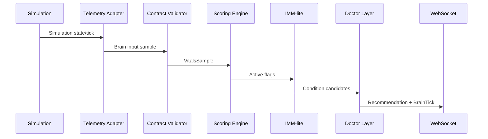

# Backend Reference

**Package:** `backend/src/astro_brain`  
**Service version:** AstroCare unified service  
**Contract version:** `astro-brain 0.6.0`

---

## 1. Backend responsibility

The backend is the single authority for:

- input validation;
- NEWS2;
- radiation, lifestyle, environment and cabin CO2 flags;
- IMM-lite condition ranking;
- Doctor Layer recommendations;
- mission reports;
- HTTP transport;
- WebSocket BrainTick broadcasting.

It does not generate physiology, render the UI, or calculate frontend triage.

---

## 2. Processing flow



---

## 3. Input contract

Required fields:

| Field | Type | Unit/range |
| --- | --- | --- |
| `timestamp` | string | ISO-8601 UTC |
| `astronaut_id` | non-empty string | — |
| `hr` | integer | 0-300 bpm |
| `spo2` | integer | 0-100 % |
| `bp.systolic` | integer | 0-300 mmHg |
| `bp.diastolic` | integer | 0-300 mmHg, ≤ systolic |
| `temp_c` | number | 25-45 °C |
| `resp_rate` | integer | 0-80 breaths/min |
| `radiation_dose_rate` | number | ≥0 µSv/h |

Important optional fields include exercise, calories, sleep, mood, NOAA S-scale, cumulative dose, mission day/phase, ppCO2, IOP, HRV, PVT and medical kit.

Booleans are never accepted as numbers. Unknown extra keys are ignored.

---

## 4. Scoring components

| Component | Source module | Output |
| --- | --- | --- |
| NEWS2 | `news2.py`, `vitals_flags.py` | Component flags, total score. |
| Radiation | `radiation.py` | Elevated/critical and cumulative-limit flags. |
| Lifestyle | `lifestyle.py` | Exercise, calories, sleep, mood. |
| Environment | `environment.py` | Cabin CO2, PVT, IOP. |
| IMM-lite | `conditions.py` | Up to three possible conditions to monitor. |
| Doctor Layer | `doctor/` | Recommendation and source. |

`alertLevel` is the worst active flag severity: `green`, `yellow` or `red`.

---

## 5. Doctor Layer

Mode sequence:

1. Cache for identical flag set.
2. Local Ollama model when enabled.
3. Deterministic rule-based fallback.

`doctorSource` is one of:

- `llm`;
- `cache`;
- `fallback`.

Setting `ASTRO_DOCTOR_OFFLINE=1` disables Ollama and uses fallback only.

---

## 6. Unified service

File:

```text
backend/src/astro_brain/astrocare_service.py
```

Adds simulation, What-If and NASA status behavior while preserving existing Brain routes.

---

## 7. State and reports

The backend keeps:

- latest output per astronaut;
- bounded recent history;
- mission episodes;
- report summary.

Reports use the existing AstroCare mission-log implementation and can be returned as JSON or SBAR-style text.

---

## 8. Dependencies

Backend runtime dependencies:

- Python 3.11+;
- Pydantic v2 for shared contracts used by simulation and adapters.

The original Brain is intentionally standard-library based. Ollama is optional.

---

## 9. Safety statement

NEWS2 was developed for adult hospital patients and has not been validated for astronauts or microgravity. AstroCare outputs are decision-support signals, not diagnoses or treatment instructions.
