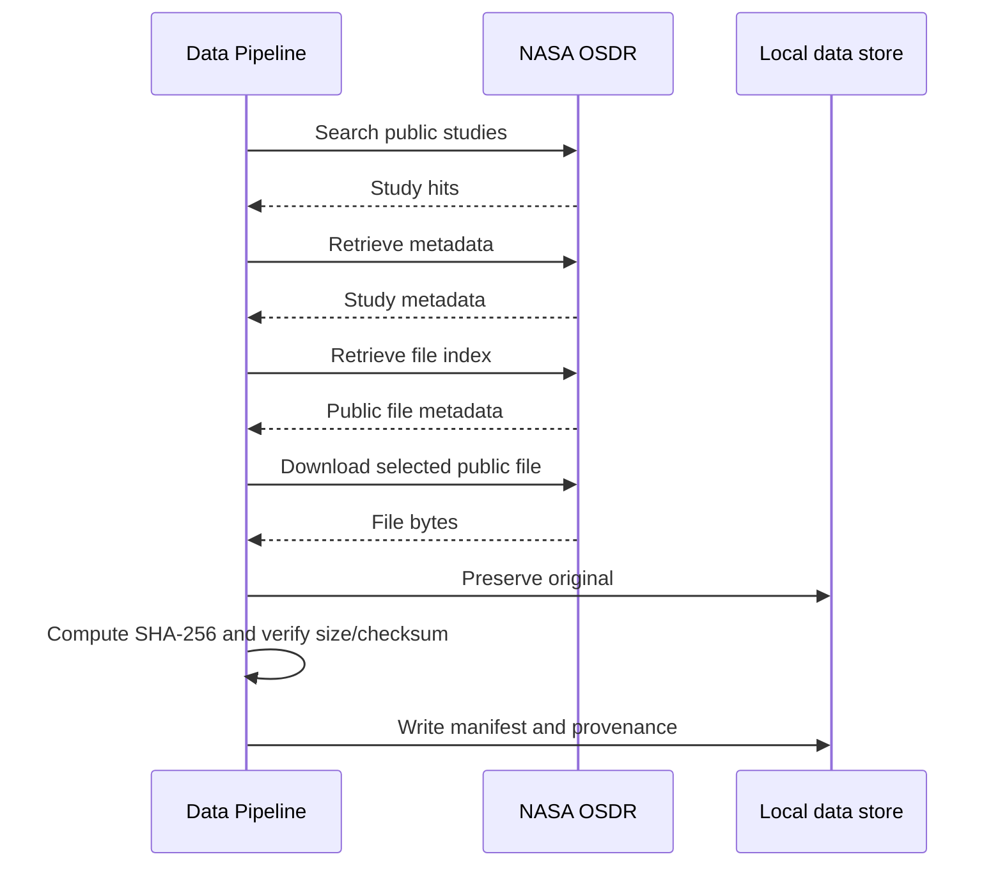

# NASA Data Acquisition and Processing

**Version:** 2026-11-15  
**Primary source:** NASA Open Science Data Repository (OSDR).  
**Data policy:** public data only; restricted files are not requested.

---

## 1. Objectives

The NASA pipeline establishes traceable scientific evidence for AstroCare. It does not fabricate continuous astronaut telemetry from sparse laboratory data.

---

## 2. Source interfaces

| Interface | URL pattern | Use |
| --- | --- | --- |
| Metadata | `https://osdr.nasa.gov/osdr/data/osd/meta/{numeric_id}` | Study title, description, assays, publications. |
| File index | `https://osdr.nasa.gov/osdr/data/osd/files/{numeric_id}` | File name, size, category, visibility and access. |
| Search | `https://osdr.nasa.gov/osdr/data/search?term=...&size=...&from=...` | Discovery by topic. |
| Study page | `https://osdr.nasa.gov/bio/repo/data/studies/OSD-###` | Public study landing page. |

The numeric OSDR identifier is required. `OSD-569` becomes `569`.

---

## 3. Discovery criteria

Studies are selected when they are public and relevant to human spaceflight physiology or supporting biological mechanisms. Discovery topics include:

- human spaceflight and astronaut physiology;
- cardiovascular adaptation and orthostatic intolerance;
- sleep and circadian disruption;
- immune response;
- fluid redistribution and SANS;
- radiation;
- musculoskeletal changes;
- metabolomics, proteomics and transcriptomics;
- blood, urine and microbiome measurements.

Each candidate is recorded with its actual title, mission, organism, assay type, file availability, access status and relevance. Non-human or unrelated studies remain in the catalog with explicit rejection reasons.

---

## 4. Verified studies

| Study | Scope | Processing role |
| --- | --- | --- |
| OSD-569 | Whole blood measurements from Inspiration4; CBC and omics. | CBC values retained as `NASA_REAL`. |
| OSD-570 | PBMC snRNA/snATAC and immune repertoire. | Metadata and selected public files; not treated as vitals. |
| OSD-571 | Plasma proteomics, EVPs, metabolomics, cfDNA/cfRNA. | Metadata and selected processed tables. |
| OSD-572 | Crew oral, nasal and skin microbiome. | Species abundance used for derived diversity. |
| OSD-573 | Dragon capsule microbiome swabs. | Cataloged environmental evidence. |
| OSD-575 | Serum CMP and immune/cardiac cytokine panels. | Laboratory values retained. |
| OSD-656 | Urine inflammation panel. | Laboratory values retained. |

---

## 5. Acquisition workflow



Download properties:

- timeout and retry handling;
- deterministic local cache path;
- SHA-256 verification;
- expected-size verification;
- cache fallback when refresh fails;
- restricted/invisible files skipped;
- large raw sequencing files not downloaded by default.

---

## 6. Parsing and normalization

Supported selected formats include CSV, TSV, JSON, XLSX, TXT and ZIP. Parsers do not assume that every table is a vital-sign stream.

Normalization rules:

1. Preserve the original value string.
2. Preserve the original unit.
3. Normalize only units present in the documented unit map.
4. Retain unknown units with `VALID_WITH_WARNINGS`.
5. Retain missing values as null with `MISSING`.
6. Retain invalid numerics as null with `SUSPECT`.
7. Preserve OSDR labels such as `L-92` and `R+1`; do not invent timestamps.
8. Preserve de-identified subject IDs.

---

## 7. Quality control

Checks include:

- missing values;
- invalid or missing units;
- duplicate detection where applicable;
- impossible physiological values;
- timestamp monotonicity and gaps;
- subject and timepoint consistency;
- baseline sufficiency;
- provenance completeness.

The bundled quality report is:

```text
data/manifests/data_quality_report.json
```

---

## 8. Feature extraction

### Real laboratory observations

Real analytes from CBC, CMP, cytokine and urine panels are retained as `NASA_REAL` observations with original units and source metadata.

### Microbiome diversity

OSD-572 species abundances are used to calculate Shannon diversity. This is classified `NASA_DERIVED` and includes the transformation method.

### Evidence summaries

Laboratory values are summarized by study, panel, analyte, timepoint and unit. Summary statistics are `NASA_DERIVED`; no clinical threshold is inferred from a summary alone.

---

## 9. Storage

| Artifact | Path |
| --- | --- |
| Original public NASA files | `data/raw/nasa/` |
| Download and checksum manifest | `data/manifests/download_manifest.json` |
| Bundle summary | `data/manifests/bundle_manifest.json` |
| Quality report | `data/manifests/data_quality_report.json` |
| Study catalog | `data/reference/study_catalog.json` |
| Dataset registry | `data/reference/dataset_registry.json` |
| Radiation audit | `data/reference/radiation_evidence.json` |
| Laboratory statistics | `data/processed/nasa_lab_reference_statistics.json` |
| Microbiome diversity | `data/processed/microbiome_diversity.json` |

---

## 10. Reproduction

Full rebuild:

```bash
python -m data_pipeline.build_offline_bundle
```

Offline rebuild:

```bash
ASTRALIS_OFFLINE_DATA=1 python -m data_pipeline.build_offline_bundle
```

The bundle builder is deterministic for the same cached inputs and configuration. Network access is required only for fresh OSDR retrieval.

---

## 11. Explicit non-goals

The pipeline does not:

1. fabricate continuous HR, HRV, blood pressure or SpO2 from laboratory panels;
2. infer subject identities;
3. access controlled OSDR data;
4. execute downloaded code;
5. label derived or synthetic values as `NASA_REAL`.
