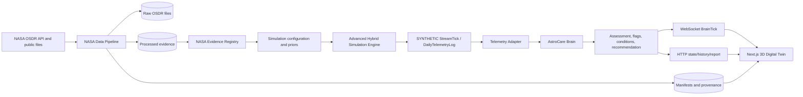
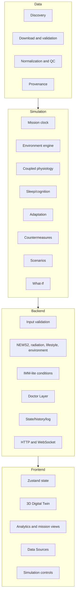

# AstroCare System Architecture

**Version:** 2026-11-15  
**Status:** unified local demonstration architecture  
**Classification:** research and decision-support prototype; not a medical device.

---

## 1. System context

AstroCare integrates four previously separate capabilities into one system:

1. NASA OSDR acquisition and scientific evidence preparation.
2. An Advanced Hybrid Simulation Engine.
3. The AstroCare Brain for medical and operational assessment.
4. An interactive Next.js 3D Digital Twin.

The system supports explicit provenance classes:

```text
NASA_REAL      Observed or published NASA/OSDR value.
NASA_DERIVED   Calculated from NASA data using a documented method.
SYNTHETIC      Generated by the AstroCare simulation engine.
```

These classes are never mixed without a label.

---

## 2. Context diagram



---

## 3. Component architecture



---

## 4. Runtime architecture

The local runtime uses one unified Python service:

```text
backend/src/astro_brain/astrocare_service.py
```

It hosts:

- the existing AstroCare Brain;
- the existing HTTP dashboard routes;
- the WebSocket broadcaster;
- simulation lifecycle and scenario control;
- NASA bundle status;
- the simulation-to-Brain feed loop.

This is a deliberate integration choice for the competition demonstration. It avoids a second API implementation while preserving the Brain as the sole medical analytics component.

---

## 5. Data flow

### NASA evidence flow

1. Query public OSDR metadata and file indexes.
2. Select public, relevant files.
3. Download and verify SHA-256.
4. Preserve originals under `data/raw/nasa/`.
5. Parse and normalize values without imputation.
6. Run quality checks.
7. Extract supported laboratory and microbiome features.
8. Record provenance and limitations.
9. Publish manifests to the Data Sources interface.

### Live simulation flow

1. Simulation advances mission time.
2. Scenarios update environment targets.
3. Physiology, cognition and adaptation states update at configured rates.
4. Telemetry is serialized with `SYNTHETIC` provenance.
5. Adapter converts units and identifiers.
6. Brain validates and analyzes the sample.
7. WebSocket broadcasts a BrainTick.
8. Frontend updates the selected astronaut view.

---

## 6. Responsibilities and boundaries

| Component | Owns | Does not own |
| --- | --- | --- |
| Data pipeline | OSDR discovery, ingestion, checksums, normalization, evidence artifacts. | Continuous vitals generation. |
| Simulation engine | Physiological/environmental state and synthetic telemetry. | Medical diagnosis or clinical scoring. |
| Brain | NEWS2, flags, conditions, doctor recommendation, reports. | Sensor acquisition or UI rendering. |
| Frontend | Visualization, interaction, local state, provenance display. | Independent medical calculations. |

---

## 7. Deployment view

Native verified mode:

```text
scripts/run.sh
```

Processes:

1. Unified Python service on port `8765`.
2. WebSocket on port `8787`.
3. Next.js development server on port `3000`.

A Docker Compose file is provided for local experimentation, but the verified primary path is native because the current Python HTTP/WebSocket servers were originally designed for local development.

---

## 8. Offline architecture

After setup and NASA acquisition, the application can run offline:

- cached OSDR files and manifests remain local;
- simulation requires no external service;
- Brain uses deterministic rule-based fallback when Ollama is unavailable;
- frontend serves local assets and clearly labels mock mode.

NASA refresh requires internet. Stale NASA data is timestamped and never represented as a fresh retrieval.

---

## 9. Failure containment

| Failure | Containment |
| --- | --- |
| Ollama unavailable | Deterministic doctor fallback. |
| Simulation processing error | Feed loop logs and stops; HTTP service remains available. |
| Invalid Brain input | HTTP 400; no guessed values. |
| WebSocket disconnect | Frontend reconnects and clearly indicates state. |
| Optional 3D asset missing | Procedural/2D fallback; no unexpected asset request. |

---

## 10. Security posture

The current system is designed for local demonstration:

- no secrets are committed;
- external network access is limited to explicit NASA retrieval or optional local Ollama;
- Brain input is strictly validated;
- downloaded files are not executed;
- frontend does not expose internal filesystem paths.

Production deployment would require authentication, restricted CORS, TLS, request limits, persistent storage hardening and audit logging.
